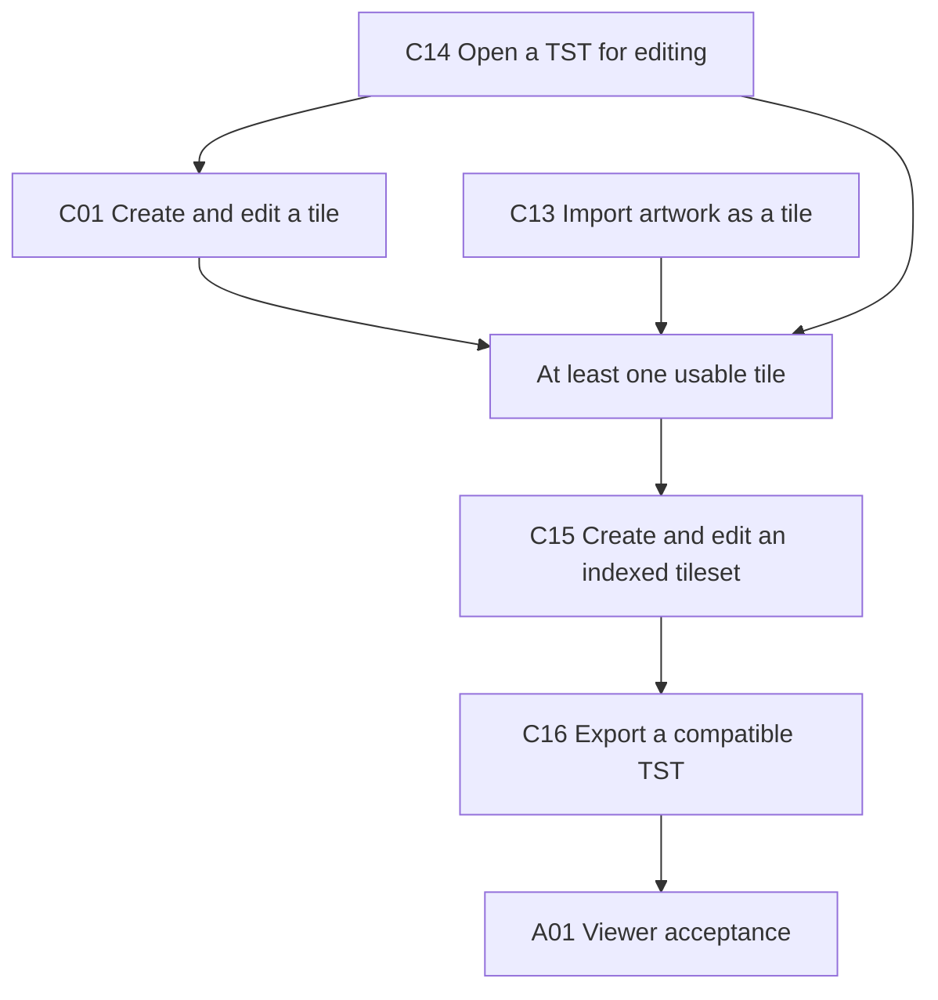

# Toolkit authoring capabilities

This graph starts with A01, the cave terrain tileset from the
[owner-led game intake](https://github.com/jmbjr/rpgtk_godot/issues/142).
It describes what an author must be able to do. Tool selection and web features
are tracked separately from prerequisites.

The [project authoring workflow](AUTHORING_WORKFLOW.md) tracks W01–W07, including
the local requirement-bound C01 workflow and planned review and build selection.

## A01 tile and tileset dependencies

The usable-tile node is an **OR gate**. An author can draw a tile, import art,
or start with a tile from an existing TST. Opening a TST also supplies tile art
for editing through C01. Adding an unchanged imported tile needs no pixel edit.
The gate applies to assembling a usable tileset. An editor can still allow the
author to start an empty set. C17 applies when the artwork needs transparency.

| ID | Capability | Acceptance |
| --- | --- | --- |
| C01 | Create and edit an individual tile | Create a tile, save it, reopen it, change pixels, and verify that the edit persists. |
| C13 | Import artwork as a tile | Import a single image or extract a cell from a sheet and verify its pixels and dimensions. |
| C14 | Open an existing TST for editing | Open a compatible TST and expose its tiles with their original slot numbers. |
| C15 | Create and edit an indexed tileset | Create and reopen a set, append a tile, and replace slot artwork while preserving the numbers of existing tiles. |
| C16 | Export a Toolkit-compatible TST | Export a tileset and open it in the online viewer. Verify the tile numbers, count, and appearance against the authored set. |
| C17 | Author and preserve tile transparency | Set or import transparent pixels and verify their appearance after export. |

A01 uses original 32×32 square terrain tiles for floor, wall, and an exit edge.
Its initial path is C01 → C15 → C16, with C13 available if the artwork is created
elsewhere. C14 covers a future editing workflow for existing Toolkit assets.
C17 is conditional for A01 and also applies to A02 if Bruce's art uses
transparent pixels. The downstream A05 board check verifies that a board cell
still resolves its tile after the artwork in that slot changes.

### Project context and capability status

The tile-supply OR gate remains valid for both internal and external tools.
Drawing artwork can occur independently; the integrated project workflow must
retain the originating requirement and assignment when a person creates,
opens, imports or saves artwork. C01's pixel round trip is accompanied by
W03/W04 assignment and proposed-variant persistence. An individual tile can
contribute to A01 without fulfilling its entire tileset requirement. Review
and exact build selection are separate W05/W06 outcomes.

| Capability | Current web Toolkit authoring support | Other evidence and limits |
| --- | --- | --- |
| C01 | Local requirement-bound pencil editor for one opaque 32 × 32 tile, with color selection, previews and GPH save/reopen | The synthetic round trip covers the editor workflow. Owner artwork, Toolkit execution and A01 fulfillment have separate acceptance. |
| C13 | Missing artwork-to-editable-tile import | The viewer previews images from archives; this does not convert artwork into a tile for authoring |
| C14 | Missing editable-TST opening | Existing TST inspection exposes numbered previews; it does not provide an editable tileset |
| C15 | Missing indexed tileset authoring | Repository fixture builders generate predetermined sets; they are not a general author-facing assembly workflow |
| C16 | Missing author-facing TST export | Existing readers/tests and synthetic TST writers provide implementation evidence; JSON/PDF exports do not fulfill C16 |
| C17 | Missing transparency authoring | Existing decoders/previews exercise transparency; authoring and export preservation still need verification |

Contributor skill (for example, pixel art or tool familiarity), implemented
software capability, available inputs and requirement fulfillment are separate
facts. Work filters must distinguish them and allow alternative production
routes. The workflow contract records the requirement-to-variant links and
the evidence needed before an external route can count as verified support.

## Tools and processes to evaluate

| Capability | Candidate implementation path | Web Toolkit feature candidate |
| --- | --- | --- |
| C01 | Pixel-art editor or the native Toolkit tile editor | Draw, edit, and save individual tiles. |
| C13 | Image or sheet prepared in an external editor | Import an image or extract tiles from a grid. |
| C14 | Native Toolkit workflow or a compatible reader feeding an editor | Open a TST as editable artwork and numbered slots. |
| C15 | Native Toolkit tileset workflow or an indexed asset pipeline | Assemble or update numbered slots. |
| C16 | Native Toolkit export or a compatible writer | Export a TST and verify it through the existing viewer. |
| C17 | Art editor and compatible encoding workflow | Preview transparency and preserve it on export. |

These production paths are candidates pending a round-trip check. The
[Explorer inventory](../CAPABILITIES.md) records inspection and preview support.
The [pinned authoring references](TK3_AUTHORING_REFERENCES.md) document Toolkit
behavior. For A01, a path through C13 → C15 → C16 could unblock production if
tile artwork already exists. C01 remains a reusable authoring capability for
later terrain and sprite assets.
