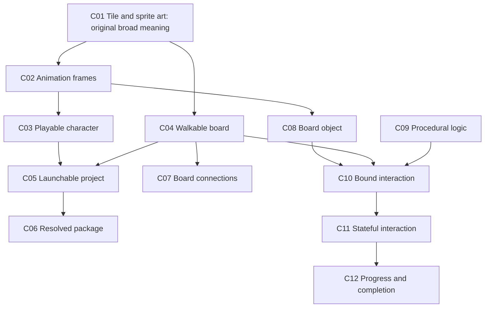

# RPGTK intake: recovered source and reconciliation

Repository: `jmbjr/rpgtk_godot`. Recovered November 24, 2026 (America/Los_Angeles).

This record consolidates original messages read directly in both shared transcripts. It supersedes the earlier claim that A03/A04/A06 and authoring C02–C12 were unrecoverable. It records source evidence, not completed implementation or accepted game assets. This narrative records the recovery checkpoint. The surrounding project records now integrate that baseline; support and acceptance remain separate evidence.

## Sources and the recovery finding

- S1: https://chatgpt.com/share/6b066b7e-7f84-83e8-9254-2234e4563741 — “Conduct game intake.” Original owner decisions, A01–A06, ordered additions, tile-capability refinement, and reported PR #144 handoff are visible. The first full authoring-graph response appears only as a fallback link here.
- S2: https://chatgpt.com/share/6b066c3d-be20-83e8-91af-4c71af255910?ogimg=plain — also “Conduct game intake.” This capture exposes that same original authoring-graph response in full, including C01–C12, explicit edges, and asset mappings. It also includes a later recovery answer that still calls the graph unavailable; the directly displayed original response resolves that source gap.

The missing graph is assistant message `295fcf1b-2d42-5814-ac1d-ec5a2a31d153`, immediately after the owner said “Sure seems ok to start with” and requested the capability graph. The launch-bundle draft is assistant message `c930e455-462f-5e76-bd03-ee17f20237aa`. The owner’s review/request is message `bbb21d91-fc74-4dee-afd7-2d01d1027879`.

These identifiers locate source messages; they are not invented URL anchors. The web reader failed to fetch these URLs; ordinary HTTP returned only a share shell. Browser-rendered transcripts provided the actual evidence. No sign-in was required to read these shared copies.

## Decision authority

1. Direct owner choices establish intended game behavior and constraints.
2. The asset draft received the owner’s “ok to start with” review. Treat it as the reviewed starting baseline, not acceptance of completed artwork or a final immutable design.
3. The full capability graph is an assistant-authored decomposition responding to that request. Preserve its provenance and later refinements; do not represent every edge as a separately approved owner decision.
4. Later repository documents establish what reached the repo at their stated checkpoints. Historical support claims in the transcript need current implementation verification before reuse as present-day claims.

## Game scope and recovered decisions

Bruce is the playable lead in a newly authored reboot. He explores a comic, fourth-wall-aware Demo, talks to residents, and follows a countdown of clues or anomalies. The owner explicitly chose multiple connected boards, a scrolling map, more locations, and more people than the original single-screen experience. The village can grow into the larger game’s main village.

Tintagel is the selected starting layout reference. Portmeirion was the assistant’s initial village suggestion; Clovelly was another option, and the owner said it looked interesting. Neither replaces the owner’s Tintagel choice. The Dragon Warrior/Tantegel discussion did not establish a confirmed naming derivation or a requirement to copy a map.

The working opening starts in Merlin’s Cave. The owner clarified the route: a path climbs the cliff side to the island’s main road; left leads to the bridge and right leads to town. This supersedes the earlier assistant proposal for a village on the mainland side. Keep the opening area separate, the approach small, the cave departure one-way, and the village as the only onward playable destination. The precise number and division of approach/town boards remain implementation proposals; a distinct upper town district was optional.

The bridge is the apparent objective, but the owner said no progress is made on it during the Demo. The reviewed draft keeps it broken, blocks crossing, shows the mainland beyond it, and leaves the anomaly countdown unchanged. Bridge repair is not a completion requirement.

The owner wants conversations, item pickup, item use that affects access, and a quest capability. A key opening a building is the recorded item-use example; the building and route are deferred. Mac’s lost Guphen illustrates a request → find → return → complete-once loop. The owner explicitly corrected the assistant’s overfocus on that quest: it is one of several things, and the immediate goal is an asset burndown and capability graph, not settling story details.

The returning cast includes Loyalis, Rusty, Lami, and Jim; Mac is associated with the quest example. Jim was a placeholder name for the larger game’s eventual antagonist, not a requirement to resolve that role in the Demo. Additional character designs exist with the owner but were not specified here.

A temporary companion joining, enabling an action, and leaving was requested, then explicitly deferred in the next question batch. Identity, ability, visible following, and cross-board behavior remain open. Do not erase the deferred need or treat it as current launch work.

Retain the comic countdown goal; exact discoveries, count, ending trigger, final scene, and replay presentation remain open. The original Demo’s thirteen clues and Q ending are historical evidence, not automatically requirements for the new game.

Start with core Toolkit data and ordinary procedural RPGCode; combat, custom plugins, and advanced class libraries were provisionally excluded. The assistant recap provisionally omitted menu browsing as a clue requirement. Menu presentation, inventory UI, and save/resume remain independent open choices. Keep game rules in content and runtime support generic. Private original archives/assets/source/DLLs remain private unless separately authorized.

## Original asset ledger: reviewed starting launch bundle

| ID | Asset | Dependencies and purpose | Recorded acceptance |
| --- | --- | --- | --- |
| A01 | Cave terrain tileset, TST | New reusable square 32×32 terrain for floor, wall, exit edge/threshold; provides numbered tiles to A05 | Preview tiles and identify board uses; verify count, slots and appearance after export; later verify replacing a slot preserves its board reference |
| A02 | Bruce walking artwork, TST | Sprite artwork for four facings; supplies A03 | Preview sprite tiles and check every facing; exact frames per facing and new visual style remain open |
| A03 | Bruce walking animations, four ANM files | References frames in A02 | Preview each animation and resolve frame references |
| A04 | Bruce playable character, TEM | Binds the directional A03 animations | Inspect Bruce and follow all four walking-animation links |
| A05 | Merlin’s Cave, BRD | Uses A01; contains authored spawn and collision boundaries | Preview board; in Play Bruce appears at spawn and can walk; existing numbered tile reference survives replacement art |
| A06 | Main project file, GAM | Binds A04 and A05 into normal launch | Upload resolved ZIP, use normal Play to enter the cave, and Reset to authored spawn |

All six make a minimum coherent playable ZIP together; they may be authored individually. Nothing here establishes actual created or accepted game assets.

Recovered asset-reference edges: A02 → A03 → A04; A01 → A05; A04 AND A05 → A06. Packaging is also required to deliver the launch bundle. Board preview can precede player integration; the walking acceptance needs the complete relevant launch context.

Original A01 breakdown labels:

- A01.1: create target-grid artwork for floor, wall, exit edge; subsequently separated into the reusable tile capability.
- A01.2: assemble/maintain indexed tiles and preserve slot numbers; corresponds to later C15.
- A01.3: encode/export compatible TST while preserving order/appearance; corresponds to later C16.

The exit threshold is visual. A05 owns collision; a later transfer owns destination behavior. Corners are added only if needed by the first layout. Palette, motif, exact pixel references, and detailed style were not chosen in the visible intake.

## Ordered additions in the reviewed starting draft

These rows originally had order numbers, not additional A-series IDs. Do not invent original IDs for them.

| Order | Addition | Acceptance |
| --- | --- | --- |
| 1 | Cliff/coast TST, approach BRD, cave-exit trigger/PRG where needed | Leave cave, reach road fork, verify one-way cave transfer in Play |
| 2 | Broken-bridge artwork and placement | Left branch reaches blocked crossing, mainland is visible, no progress awarded |
| 3 | Village TST, first scrolling town BRD, road connections | Right branch enters town; verify camera scrolling and return connection separately; add later boards individually |
| 4 | Residents individually: art, ANM, ITM, dialogue PRG | Preview placement, trace program link, talk in Play; known cast Loyalis/Rusty/Lami/Jim/Mac |
| 5 | Quest item and quest programs | Inspect links; accept, acquire, return and complete once; Guphen is an example |
| 6 | Key/ITM, lock or door graphics, activation PRG, destination BRD if needed | Access blocked before key use and allowed afterward; building choice open |
| 7 | Discovery/ending programs and triggers | Discoveries count once; bridge leaves count unchanged; normal Play reaches ending; replay starts clean |

Track editable source → packaged file → dependencies → provenance/license → viewer result. Draft status sequence: proposed → owner-selected → created → imported → exercised → owner-accepted. Import/inspection and normal-Play execution remain separate evidence classes.

## Recovered authoring C01–C12

This is the graph visible directly in S2. C01’s broad initial definition was narrowed later in the same conversation; retain the later C01 meaning together with C13–C17 rather than silently restoring the old broad meaning.

| ID | Original authoring capability | Scope evidenced in original response |
| --- | --- | --- |
| C01 | Create reusable tile and sprite art | Addressable terrain tiles and sprite frames; later refined to create/edit one tile, with import/tileset/export split out |
| C02 | Define animation frames | Frame references, order, timing and transparency |
| C03 | Define a playable character | Character definition and directional-animation bindings |
| C04 | Build a walkable board | Terrain layout, dimensions, layers, collision and player spawn |
| C05 | Configure a launchable project | Bind starting board and playable character |
| C06 | Package a resolved project | Importable ZIP with resolvable references; applies at every checkpoint |
| C07 | Connect boards | Transfer trigger, destination board and arrival position; one-way cave exit is the first proof |
| C08 | Define a board object | Object/item definition, linked artwork/animation as applicable |
| C09 | Author procedural dialogue and logic | Ordinary RPGCode programs for interactions and rules |
| C10 | Place and bind an interaction | Object or board placement/activation tied to its program |
| C11 | Author stateful interactions | Quest acceptance/acquisition/turn-in/completion and repeat behavior; key/access conditions and effects |
| C12 | Author progress and completion | Count discoveries once, maintain countdown, reach ending and restart cleanly |

Original graph edges (a recovered proposal, not a newly validated universal dependency model):

Do not turn every original arrow into an unavoidable tool gate. Later tile-supply alternatives refine the C01 edges, and a static object may not need authored animation. Preserve the original graph as evidence while explicitly recording any later dependency refinement.

### Original direct asset-to-capability mapping

| Asset/addition | Original direct mapping |
| --- | --- |
| A01 cave TST | C01 |
| A02 Bruce sprite TST | C01 |
| A03 ANMs | C02 |
| A04 TEM | C03 |
| A05 cave BRD | C04 |
| A06 GAM and launch package | C05, C06 |
| Cliff approach and cave exit | C01, C04, C07 |
| Broken bridge | C01, C04 |
| Scrolling town and roads | C01, C04, C07; camera follow is a separate Play check |
| Residents | C01, C02, C08 for art/animation/object; C09, C10 for dialogue and activation |
| Quest | C01, C08, C09, C10, C11 |
| Key and access | C01, C08, C09, C10, C11; C07 if access enables a transfer |
| Discoveries and ending | C09, C10, C11, C12 |

C06 applies at each packaged checkpoint, even where omitted from a row. These original C01 mappings used the broad art meaning, not a claim that the later pencil editor alone produces complete TSTs.

## Later tile-capability refinement preserved on main

| ID | Refined capability | Proof |
| --- | --- | --- |
| C01 | Create/edit an individual tile | Blank or reopen → edit → save → reopen → edit again; pixels persist |
| C13 | Import artwork as a tile | Image or sheet cell imports with verified dimensions/pixels |
| C14 | Open an existing TST for editing | Expose original numbered slots; preserve their identity |
| C15 | Create/edit indexed tileset | Reopen, append or replace artwork while preserving existing numbers |
| C16 | Export compatible TST | Viewer round trip preserves count, slots and appearance |
| C17 | Author/preserve transparency | Preview and export preserve transparent pixels; conditional on the art |

Supply usable art via C01 OR C13 OR eligible C14 input, then C15 and C16, with C17 where required. C14 can feed C01 for editing. External artwork can be imported unchanged without a mandatory web pencil step. Initial A01 new-art route: C01 → C15 → C16. A01 still needs all required terrain roles; one submitted tile is a contribution, not whole-tileset fulfillment.

## ID collision: player outcomes are a separate ledger

The opening archive assessment reused C01–C06 for candidate player outcomes before the authoring graph was introduced. These are not the authoring C IDs. Preserve source IDs with an explicit ledger kind/namespace; do not join records on a bare C number.

| Original player-outcome ID | Meaning |
| --- | --- |
| C01 | Start a fresh game and walk in opening area |
| C02 | Learn why Bruce is here and what to do next |
| C03 | Talk or inspect and receive a meaningful response |
| C04 | Discover progress with sensible repeat behavior |
| C05 | Reach ending and replay cleanly |
| C06 | Menu, item carrying/use, or save/resume if needed; these are independent choices |

The authoring graph also initially gave authoring C01 a broader art meaning before the owner requested explicit individual tile creation/editing. Preserve this evolution with revision/source attribution. No silent renumbering is required to recover the history.

Later W01–W07 describe project connection, contributor matching, attached assignment, proposed variant persistence, exact-revision review, build selection and reopening/tracing. They are a separate workflow layer, not replacements for game outcomes or asset-production capabilities.

## Archive inspection: recovered historical report

The original assistant reported inspecting `BSTW_EXPO_DEMO(1).zip`, matching historical #92 with SHA-256 `77d6d4180948196106e3d4dad7e2ee62144b30fac8c7ac5491048740e9864300`; ZIP integrity passed with 300 entries, including 285 files. This recovery read that report; it did not rehash or rerun the private archive.

The report distinguishes inferred old title/town/discovery/ending behavior from execution evidence. At its main checkpoint `840f7c5`, a direct-board check reached Bruce’s art and movement while shared startup stopped at a class declaration in `CArray.prg:11`. Original Toolkit execution and full current-browser completion were not established by that intake. No private source or asset bytes are reproduced here.

## What went missing in the handoff

Original transcript evidence now establishes that the intake, reviewed A01–A06 bundle, ordered additions and authoring graph existed. Earlier repo review established only the A01 tile slice in #144/main, later W workflow in #145, and W02/W03 follow-up in #147/#148. Intake issue #142 still reported waiting for the conversation/ZIP when checked. Draft #149 contained a partial reconstruction and local planning IDs; it must not override recovered A03/A04/A06 or A05’s cave-specific meaning.

This is evidence of an incomplete durable handoff and incomplete retrieval, not evidence that the owner failed to define the scope. The exact cause of earlier chats lacking their own earlier messages was not diagnosed.

The local current session previously verified #149 as an open draft, branch `plan/bstw-studio-baseline`, head `666a30875a0e46bb561e1b7aec14395f01085dab`, with main at `2c7128746f748bb0aa0459c36675a2e190a26f16`. These remain point-in-time observations, not fresh deployment or acceptance checks in this recovery.

## Reconciliation needed before a trustworthy derived director view

This is a proposed integration contract, not already implemented behavior:

1. Store the recovered intake and provenance at one canonical project entry point; link it from #142 and the roadmap. Record that archive inspection/intake occurred without claiming final resolution of open creative choices.
2. Restore A01–A06 and original additions in project data. Reconcile #149’s planning-local candidate records without reusing A05 for all boards or erasing source identities.
3. Restore authoring C02–C12 and their original mappings beside current C01/C13–C17. Preserve player-outcome identities in a distinct ledger. Model dependency refinements explicitly.
4. Keep project decisions, studio evidence and scenario overrides separate. Actual roster, willingness, hours, selected tool access and effort estimates were not specified in the recovered intake.
5. Derive the director view from exact project/studio/scenario revisions and a versioned evaluator. Show every source gap, blocker and unknown; a cached view must identify its inputs. Same inputs and rules produce the same result.
6. Validate references and revisions so a fresh session opens the project and recovers these records without chat history. Changing an availability assumption recalculates affected work and explains why. Completion requires evidence about exact output revisions, not merely startable work or scenario assumptions.

## Remaining creative and production choices

- Exact art style, palette, frames per facing, geometry, dimensions, spawns and final board split.
- Detailed discoveries/count, Guphen identity/location/countdown relationship, key destination, extra residents, dialogue and exact comic ending/replay presentation.
- Companion details, deferred scope and visual representation; final menu/inventory/save/load/combat/native acceptance choices.
- Work-item IDs, chosen verified production routes, actual studio roster/capacity, effort estimates and schedules.
- Actual game asset revisions, review decisions, build selections, current support and deployed owner acceptance.

The C02–C12 authoring graph and A03/A04/A06 definitions are no longer in this gap list: S2 directly recovers them. No further retelling of this intake is needed to preserve the recovered baseline.
